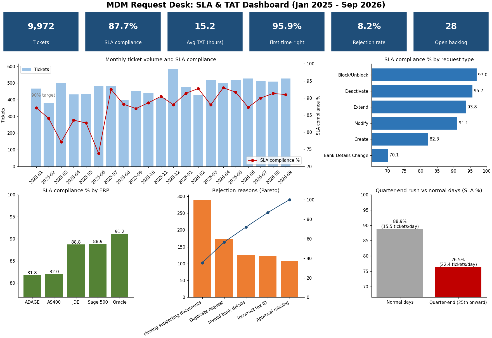

# SLA & TAT Analytics for an MDM Request Desk

Analytics for a **ServiceNow-style ticket queue** handled by a Customer & Vendor Master Data (MDM) team: SLA compliance, turnaround time (TAT), backlog ageing, request-type volume and rejection reasons. It answers the questions an MDM team lead asks every week: *Are we meeting SLA? Which requests are slow and why? What should we fix first?*

> All data is **synthetic** (generated by `src/generate_tickets.py`). No real company or ticket data is used.



## Results (Jan 2025 – Sep 2026, 9,972 tickets)

| KPI | Value |
|---|---|
| SLA compliance | 87.7% |
| Average TAT | 15.2 hours |
| First-time-right (closed without reopen) | 95.9% |
| Rejection rate | 8.2% |
| Open backlog at snapshot | 28 tickets (4 already breached) |

Key findings (full list in [`docs/insights.md`](docs/insights.md), regenerated on every run):
- **Bank Details Change** (70.1%) and **Create** (82.3%) requests have the lowest SLA compliance.
- **ADAGE** and **AS400** are the slowest ERPs (~82% SLA vs 91% for Oracle).
- The **quarter-end rush** (≈45% more tickets per day) drops SLA compliance from 88.9% to 76.5%.
- Two rejection reasons (missing documents, duplicate requests) cause **56%** of rejections, so an intake checklist and a duplicate check before ticket creation would remove most rework.
- SLA compliance rose from 81.4% to 90.1% after the (simulated) July 2025 process automation.

## Data model

One row per request ticket (`data/mdm_tickets.csv`):

`ticket_id, opened_at, resolved_at, domain (Customer/Vendor), request_type (Create, Modify, Extend, Deactivate, Block/Unblock, Bank Details Change), priority (P1–P4), sla_target_hours (4/8/24/48), erp_system, region, assignment_group, assigned_to, state, tat_hours, rejection_reason, reopen_count`

The generator models weekday/weekend volume, quarter-end rush, growth over time, ERP and analyst speed differences, rejections and reopens.

## SQL KPIs (`sql/kpi_queries.sql`)

| Query | What it shows |
|---|---|
| `kpi_overview` | Totals, SLA %, average TAT, rejection rate, first-time-right |
| `monthly_trend` | Monthly volume, SLA %, average TAT, breaches |
| `sla_by_request_type` / `sla_by_priority` / `sla_by_erp` | SLA % and TAT by dimension |
| `quarter_end_impact` | Tickets/day and SLA % in quarter-end weeks vs normal days |
| `rejection_pareto` | Rejection reasons with cumulative % (window functions) |
| `agent_performance` | Closed tickets, TAT, SLA % and reopens per analyst |
| `open_backlog_ageing` | Open tickets, age in hours and SLA breach status |

P50/P90 TAT percentiles by priority are computed in pandas (`outputs/tat_percentiles.csv`).

## Project structure

```
data/      mdm_tickets.csv (synthetic)
src/       generate_tickets.py, analyze.py
sql/       kpi_queries.sql
outputs/   kpi_results/*.csv, tat_percentiles.csv, SLA_TAT_Report.xlsx
docs/      dashboard.png, insights.md
tests/     pytest tests for the SQL KPIs
```

## How to run

```bash
pip install -r requirements.txt
python -m src.generate_tickets   # optional: regenerate the dataset
python -m src.analyze            # SQL KPIs, Excel report, dashboard, insights
python -m pytest -q
```

`data/mdm_tickets.csv` and `outputs/SLA_TAT_Report.xlsx` can be loaded directly into Power BI to build an interactive version of the dashboard.

## Tools

Python (pandas, NumPy, matplotlib, openpyxl), SQL (SQLite, CTEs, window functions), pytest.
